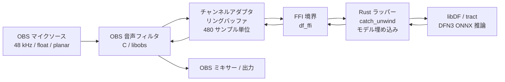

# OBS DeepFilterNet ノイズキャンセリングプラグイン 設計書

| 項目 | 内容 |
|---|---|
| ドキュメント版 | 0.2 |
| 日付 | 2026-11-18 |
| 対象 OBS | OBS Studio 32.2.1 以降 |
| 対象 OS | Windows 10/11 x64、macOS 13 以降（Universal） |
| ステータス | ドラフト（実装前） |

> 本設計でいう「ノイズキャンセリング」は、マイク 1 本に対する**ノイズ抑制（noise suppression）**を指す。参照マイクを使ったアクティブキャンセリング（ANC）は対象外とする。

---

## 0. 概要

- OBS の音声フィルタとして **DeepFilterNet3（DFN3）** を動かすネイティブプラグイン。
- 推論は **CPU のみ**。GPU は使わない。ゲーム中の GPU 負荷への影響はゼロ。
- 推論エンジンは **libDF（Rust）+ tract（純 Rust の ONNX ランタイム）**。ONNX Runtime や CUDA は不要。
- モデルはビルド時に Rust ライブラリへ**埋め込み**、実行時のモデルファイル配置を不要にする。
- C++ プラグインからは **C ABI の薄いラッパー（`df_ffi`）** を `dlopen` / `LoadLibrary` で動的ロードする。
- **GitHub Actions** で Windows x64 と macOS Universal をビルドし、インストーラ／zip を成果物として出す。

---

## 1. 目的とスコープ

### 1.1 目的

1. OBS のマイク音声に対して、RNNoise より高品質なノイズ抑制を提供する。
2. ゲーム中の GPU 負荷を増やさない（CPU 負荷も数 % に抑える）。
3. Windows と macOS の両方で同じプラグインとして動作する。
4. GitHub Actions で再現可能にビルドし、配布物を自動生成する。

### 1.2 対象

- OBS Studio 32.2.1 以降の音声フィルタプラグイン
- DeepFilterNet3 によるモノラル／ステレオのノイズ抑制
- 抑制量とポストフィルタの設定
- Windows x64 / macOS Universal のビルドと配布物
- GitHub Actions による CI（ビルド、スモークテスト、パッケージ）

### 1.3 対象外

- 2 本のマイクを使ったアクティブキャンセリング
- VST / LADSPA プラグインとしての提供
- GPU（CUDA / Metal / DirectML）推論
- Linux の公式サポート（コードは移植可能だが、v0 では CI 対象外）
- モデルの学習・ファインチューニング
- プラグインの自動アップデート

---

## 2. 要件

### 2.1 機能要件

| ID | 要件 | 内容 |
|---|---|---|
| F-1 | フィルタ登録 | OBS の音声フィルタ一覧に「DeepFilterNet Noise Cancelling」が表示される |
| F-2 | ノイズ抑制 | 48 kHz のマイク音声に対し DFN3 を適用する |
| F-3 | 設定 | 抑制量（0〜100 dB）、ポストフィルタ ON/OFF を変更できる |
| F-4 | 設定の永続化 | シーン／ソースに保存され、OBS 再起動後も復元される |
| F-5 | チャンネル | モノラルとステレオに対応する。3 ch 以上は先頭 2 ch のみ処理し、残りはそのまま通す |
| F-6 | フェイルセーフ | 推論ライブラリが読めない場合は音声を素通しし、エラーログを出す（OBS を落とさない） |
| F-7 | ログ | 起動時にプラグイン版、ライブラリパス、モデル、ホップサイズを出力する |
| F-8 | ローカライズ | en-US / ja-JP の UI 文言を用意する |

### 2.2 非機能要件

| ID | 要件 | 目標値 |
|---|---|---|
| N-1 | CPU 負荷 | モノラル時、1 コアの 5% 未満（現行デスクトップ CPU） |
| N-2 | GPU 負荷 | 0%（GPU API を一切呼ばない） |
| N-3 | 遅延 | プラグイン由来 40 ms 程度（DFN3 のアルゴリズム遅延 30 ms + バッファ 10 ms） |
| N-4 | 安定性 | 1 時間連続動作でドロップアウト・クラッシュなし |
| N-5 | 対応 OS | Windows 10/11 x64、macOS 13 以降（arm64 / x86_64 Universal） |
| N-6 | ネットワーク | 実行時の外部通信なし（モデルはバイナリに埋め込み） |
| N-7 | ライセンス | GPL-2.0（プラグイン本体）と MIT/Apache-2.0（DeepFilterNet）の両立 |
| N-8 | CI | コールドビルド 20 分以内、キャッシュ利用時 10 分以内を目標 |

---

## 3. アーキテクチャ

### 3.1 採用技術

| 要素 | 採用 | 理由 |
|---|---|---|
| 音声強調モデル | DeepFilterNet3 | 48 kHz フルバンド対応。RNNoise より高音質 |
| 推論ランタイム | libDF + tract | 純 Rust で完結。追加のネイティブ DLL が不要 |
| 推論デバイス | CPU | GPU 負荷ゼロ。ゲームと競合しない |
| OBS 連携 | C（libobs API） | OBS の音声フィルタ API に直接対応 |
| FFI | C ABI + 動的ロード | panic の隔離、配置の柔軟性、フェイルセーフ |

### 3.2 全体構成



### 3.3 レイヤ構成

| レイヤ | 言語 | 役割 |
|---|---|---|
| OBS フィルタ | C | `obs_source_info` の登録、設定 UI、音声コールバック |
| チャンネルアダプタ | C | 任意フレーム数を 480 サンプルに分割、遅延バッファ、ステレオ対応 |
| FFI ローダ | C | `os_dlopen` / `os_dlsym` による動的ロード、エラー処理 |
| Rust ラッパー | Rust | `df_ffi`。パニック捕捉、モデル埋め込み、C ABI |
| 推論 | Rust | libDF + tract による DFN3 の推論 |
| モデル | ONNX | DeepFilterNet3（48 kHz、fft 960、hop 480、lookahead 2） |

### 3.4 音声データフロー

1. OBS が `filter_audio` を呼ぶ。フレーム数は可変（通常 1024）。
2. チャンネルごとにサンプルを入力アキュムレータへ追加する。
3. 480 サンプルたまるたびに `dfx_process` を呼び、480 サンプルの出力を得る。
4. 出力はリングバッファへ積み、入力と同じフレーム数だけ取り出して返す。
5. 出力リングバッファは起動時に 480 サンプル（10 ms）のゼロでプライミングする。

---

## 4. コンポーネント設計

### 4.1 OBS フィルタ（C）

`src/deepfilter-filter.c` に `obs_source_info` を定義する。

```c
struct obs_source_info deepfilter_filter = {
    .id = "deepfilter_noise_cancelling",
    .type = OBS_SOURCE_TYPE_FILTER,
    .output_flags = OBS_SOURCE_AUDIO,
    .get_name = deepfilter_get_name,
    .create = deepfilter_create,
    .destroy = deepfilter_destroy,
    .update = deepfilter_update,
    .get_defaults = deepfilter_defaults,
    .get_properties = deepfilter_properties,
    .activate = deepfilter_activate,
    .deactivate = deepfilter_deactivate,
    .filter_audio = deepfilter_filter_audio,
};
```

| コールバック | スレッド | 処理 |
|---|---|---|
| `create` | OBS メイン | DF ステート 2 系統（L/R）を生成。DF ライブラリをロード |
| `destroy` | OBS メイン | DF ステートを破棄、ライブラリをクローズ |
| `update` | UI | 設定値をアトミック変数へ保存するだけ |
| `activate` / `deactivate` | OBS 管理 | バッファのリセットフラグを立てる |
| `filter_audio` | 音声スレッド | 480 サンプル単位で推論、入出力フレーム数を一致させる |

**音声スレッドの制約:**

- メモリ確保、ファイル I/O、ロック、ログ出力を行わない。
- 設定変更はアトミック変数経由で受け取り、フレーム境界で反映する。
- DF ステートの生成・破棄は音声スレッドでは行わない。

### 4.2 チャンネルアダプタと遅延設計

DFN3 は 48 kHz / 480 サンプル（10 ms）単位で推論する。OBS からは任意のフレーム数が来るため、以下のバッファを持つ。

- 入力アキュムレータ: 480 サンプル
- 出力リングバッファ: 480 サンプルのゼロで初期化
- 1 チャンネルあたりの状態: `df_handle`、入力位置、出力リング

**遅延内訳（48 kHz）:**

| 要素 | サンプル数 | 時間 |
|---|---:|---:|
| DFN3 STFT（fft 960 − hop 480） | 480 | 10.0 ms |
| DFN3 lookahead（2 × 480） | 960 | 20.0 ms |
| アダプタのプライミング（1 × 480） | 480 | 10.0 ms |
| **合計** | **1,920** | **40.0 ms** |

OBS やオーディオデバイス側のバッファはこれとは別に加算される。音楽制作用途ではないため、配信・通話用途では許容範囲とする。

**アンダーラン防止:**

出力リングを 1 ホップ分プライミングし、入力の端数は次回に繰り越す。1 回のコールで消費するサンプル数を N、ホップを H、出力リング残量を F とすると、処理後の補充は `N - (H - 1)` 以上になるため、初期残量 H でアンダーランしない。不足時はゼロを出力し、カウンタをログに残す。

**ステレオ:**

- 2 ch まではチャンネルごとに独立した DF ステートで処理する。
- 3 ch 以上は先頭 2 ch のみ処理し、残りはパススルーする（OBS の音声は最大 8 ch）。
- DF ステートは `create` 時に 2 系統生成する。モノラル時は 1 系統しか使わないが、音声スレッドでの生成を避けるため事前に確保する。

### 4.3 Rust FFI ラッパー（`df_ffi`）

上流の `libDF` には `capi` 機能があるが、以下の理由で独自の薄いラッパーを用意する。

- 上流 `df_create` はモデルファイルのパスを要求する。埋め込みモデルを使いたい。
- 上流 `df_create` は不正なモデルで panic する。FFI 境界を越えた panic は OBS のクラッシュにつながる。
- モノラル固定であり、エラーコードを返さない。

**公開 API（C ABI）:**

```c
typedef struct DfHandle DfHandle;

DfHandle *dfx_create(float atten_lim_db, float post_filter_beta);
void      dfx_destroy(DfHandle *h);
size_t    dfx_hop_size(const DfHandle *h);
int       dfx_process(DfHandle *h, const float *in, float *out);
void      dfx_set_atten_lim(DfHandle *h, float db);
void      dfx_set_post_filter_beta(DfHandle *h, float beta);
```

- `dfx_create`: 埋め込み DFN3 モデルから `DfTract` を生成する。失敗時は `NULL`。
- `dfx_process`: 480 サンプルを処理する。戻り値 0 が成功、負値がエラー。
- すべての入口で `std::panic::catch_unwind` を使い、panic を C 側へ返さない。
- `DfHandle` は `DfTract` と設定値のみを持つ。

**モデル埋め込み:**

`deep_filter` クレートの `default-model` 機能を使う。`models/DeepFilterNet3_onnx.tar.gz`（約 7.8 MB）がコンパイル時に `include_bytes!` される。

```toml
[dependencies]
deep_filter = { path = "../DeepFilterNet/libDF", features = ["tract", "default-model", "logging"] }
```

これにより、実行時にモデルファイルを探す必要がなく、配布物はプラグイン DLL/dylib だけで完結する。

### 4.4 libDF / tract

- リポジトリ: `third_party/DeepFilterNet`（Git サブモジュール、コミット固定）
- 固定コミット: `7b14b895fe7fc42cab72b4a4c1e49c982bd6404b`（main、2026-11 時点）
- ライセンス: MIT OR Apache-2.0（モデル重みも同ライセンス）
- 推論: `tract` 0.21 系。CPU のみ。GPU バックエンドは使わない。

**DFN3 モデル仕様（config.ini より）:**

| 項目 | 値 |
|---|---|
| サンプルレート | 48,000 Hz |
| FFT サイズ | 960 |
| ホップサイズ | 480（10 ms） |
| DF lookahead | 2 |
| conv lookahead | 2 |
| ERB バンド数 | 32 |
| DF 次数 | 5 |
| モデルサイズ | 約 7.8 MB |

### 4.5 動的ロード

C プラグインは FFI ライブラリを**リンクせず**、実行時にロードする。

| OS | ファイル名 | 探索場所 |
|---|---|---|
| Windows | `df_ffi.dll` | プラグイン DLL と同じディレクトリ |
| macOS | `libdf_ffi.dylib` | `.plugin/Contents/MacOS/` |

```c
obs_module_t *mod = obs_current_module();
const char *binary = obs_get_module_binary_path(mod); // .../obs-deepfilter-noise.dll
// ディレクトリを取得して df_ffi.dll / libdf_ffi.dylib を os_dlopen する
```

- ロードに失敗した場合は `available = false` とし、`filter_audio` は入力をそのまま返す。
- 失敗理由（パス、OS エラー）を `LOG_ERROR` で 1 回だけ出力する。
- 動的ロードにより、プラグインと Rust ライブラリのアーキテクチャ不一致をビルド時に強制せず、配布時の差し替えも容易にする。

---

## 5. 音声処理仕様

| 項目 | 仕様 |
|---|---|
| サンプルレート | 48,000 Hz 固定（OBS の音声処理レート） |
| フォーマット | float32、planar |
| フレーム数 | 可変（通常 1024）。480 の倍数を仮定しない |
| チャンネル | 1 ch / 2 ch を処理。3 ch 以上は先頭 2 ch のみ |
| 無音時 | DFN 側の無音スキップに任せる（5 フレーム連続で無音ならゼロ出力） |
| クリッピング | 入力が 0.9999 を超える場合は DFN が警告ログを出す。プラグイン側では補正しない |
| リセット | `activate` 時にアダプタのバッファをクリアする。DF の再帰状態は保持する（v0 の既知制約） |
| パススルー | ライブラリ未ロード、ステート生成失敗、3 ch 以上の余剰チャンネル |

> OBS の音声グラフは 48 kHz 固定のため、44.1 kHz ソースでもフィルタには 48 kHz で届く。将来 OBS の仕様が変わった場合は、レート変換を追加する。

---

## 6. 設定

| キー | UI 表示 | 型 | 既定値 | 範囲 | 説明 |
|---|---|---|---|---|---|
| `atten_lim_db` | ノイズ抑制量 (dB) | float slider | 100 | 0〜100 | 0 は無効、100 は最大抑制 |
| `post_filter` | ポストフィルタ | bool | false | — | 強く抑えたい場合に ON |
| `post_filter_beta` | （内部固定） | float | 0.02 | — | ON 時に 0.02 を設定 |

- OBS 標準のフィルタ有効チェックボックスをバイパスとして使う。独自の ON/OFF は持たない。
- 設定変更は `update` でアトミック変数に書き込み、次の `filter_audio` で `dfx_set_*` に反映する。

---

## 7. ビルド

### 7.1 前提

| 項目 | バージョン |
|---|---|
| OBS ソース | 32.2.1（`buildspec.json`） |
| OBS ビルド依存 | obs-deps / Qt6 2026-07-15 |
| CMake | 4.2 以上（Visual Studio 18 2026 ジェネレータ対応） |
| Rust | 1.96.0（`rust-toolchain.toml` で固定） |
| C++ | MSVC 2026 / Apple Clang（Xcode 26.5） |
| CMake ジェネレータ | Visual Studio 18 2026 / Xcode |
| macOS deployment target | 13.0 |

### 7.2 リポジトリ構成

```text
obs-plugin_noise-cancelling/
├── .github/
├── build-aux/
├── cmake/
├── data/
│   └── locale/
│       ├── en-US.ini
│       └── ja-JP.ini
├── docs/
│   └── DESIGN.md
├── src/
│   ├── plugin-main.c
│   ├── deepfilter-filter.c
│   ├── deepfilter-filter.h
│   ├── df-loader.c
│   ├── df-loader.h
│   ├── audio-ring.c
│   └── audio-ring.h
├── tests/
│   └── smoke_test.py
├── third_party/
│   ├── DeepFilterNet/
│   └── df-ffi/
│       ├── Cargo.toml
│       ├── Cargo.lock
│       └── src/lib.rs
├── CMakeLists.txt
├── CMakePresets.json
├── buildspec.json
├── rust-toolchain.toml
└── README.md
```

### 7.3 CMake 統合

1. `third_party/DeepFilterNet` をサブモジュールとして取得（CI は `submodules: recursive`）。
2. `df-ffi` を `cargo build --release` でビルドするカスタムターゲットを追加。
3. プラグインターゲットが Rust ライブラリに依存するよう `add_dependencies` を設定。
4. ビルド後のコピー:
   - macOS: `libdf_ffi.dylib` を `.plugin/Contents/MacOS/` へ
   - Windows: `df_ffi.dll` を `rundir/<Config>/` とインストール先の `bin/64bit/` へ
5. モデルファイルの実行時コピーは不要（埋め込み）。

**macOS Universal:**

`CMAKE_OSX_ARCHITECTURES=arm64;x86_64` に対応するため、Rust を 2 回ビルドして `lipo` で結合する。

```text
cargo build --release --target aarch64-apple-darwin
cargo build --release --target x86_64-apple-darwin
lipo -create <arm64 dylib> <x86_64 dylib> -output libdf_ffi.dylib
```

- `MACOSX_DEPLOYMENT_TARGET` は CMake の設定（13.0）に合わせる。
- CI では `rustup target add aarch64-apple-darwin x86_64-apple-darwin` を実行する。
- `lipo -info` で両アーキテクチャを含むことを検証する。

**Windows:**

- `x86_64-pc-windows-msvc` をビルド。
- 出力 `df_ffi.dll` をプラグイン DLL と同じ階層に配置する。
- MSVC ランタイムは Windows 10/11 に含まれるものを利用する。

### 7.4 開発者向けビルド手順

```bash
git clone --recurse-submodules <repository-url>
cd obs-plugin_noise-cancelling

# macOS（Universal）
cmake --preset macos
cmake --build --preset macos

# Windows（x64）
cmake --preset windows-x64
cmake --build --preset windows-x64
```

初回は OBS の依存関係（`.deps/`）のダウンロードと Rust のビルドが走るため時間がかかる。

---

## 8. GitHub Actions

### 8.1 ワークフロー

| ファイル | トリガー | 内容 |
|---|---|---|
| `push.yaml` | master / develop への push、タグ | ビルド → パッケージ → リリース |
| `pr-pull.yaml` | Pull Request | ビルドとフォーマットチェック |
| `dispatch.yaml` | 手動 | 任意ビルド |
| `build-project.yaml` | 上記から呼び出し | macOS / Windows の実ビルド |
| `check-format.yaml` | PR | C / CMake / Rust のフォーマット |

### 8.2 ビルドジョブ

| ジョブ | ランナー | ターゲット | 成果物 |
|---|---|---|---|
| macOS | `macos-26`（Xcode 26.5） | Universal（arm64 + x86_64） | `.pkg` / `.tar.xz` |
| Windows | `windows-2025-vs2026` | x64 | `.zip` |
| Ubuntu | （v0 では無効） | x64 | — |

Linux はビルド可能だが、v0 の公式サポート外として CI を止める。将来必要になったら再有効化する。

### 8.3 追加する CI ステップ

1. **Rust ツールチェーンのセットアップ**
   - `dtolnay/rust-toolchain` で `1.96.0` をインストール。
   - macOS では `targets: aarch64-apple-darwin,x86_64-apple-darwin` を指定。
2. **Cargo キャッシュ**
   - `Swatinem/rust-cache` を使用。
   - キーに `Cargo.lock` とサブモジュールのコミットを含める。
   - tract のビルドが重いため、キャッシュは必須。
3. **スモークテスト**
   - ビルド後に `tests/smoke_test.py` を実行。
   - Python の `ctypes` で `df_ffi.dll` / `libdf_ffi.dylib` をロードし、`dfx_create` → `dfx_process` → `dfx_destroy` を実行。
   - 出力が有限値であること、無音入力で発散しないことを確認。
4. **アーキテクチャ検証（macOS）**
   - `lipo -info libdf_ffi.dylib` で `arm64 x86_64` を確認。

### 8.4 成果物

- Windows: `obs-deepfilter-noise-<version>-windows-x64.zip`
  - `obs-deepfilter-noise/bin/64bit/obs-deepfilter-noise.dll`
  - `obs-deepfilter-noise/bin/64bit/df_ffi.dll`
  - `obs-deepfilter-noise/data/locale/*.ini`
- macOS: `obs-deepfilter-noise-<version>-macos-universal.pkg`（または `.tar.xz`）
  - `obs-deepfilter-noise.plugin/Contents/MacOS/obs-deepfilter-noise`
  - `obs-deepfilter-noise.plugin/Contents/MacOS/libdf_ffi.dylib`
  - `obs-deepfilter-noise.plugin/Contents/Resources/...`

### 8.5 リリースと署名

- セマンティックバージョンのタグ（例: `0.1.0`）で draft release を自動作成する（テンプレートの既存動作）。
- macOS の署名・公証はシークレット（Developer ID）が設定されている場合のみ実行。
- Windows のコード署名は v0 では未対応。未署名のため SmartScreen の警告が出る可能性がある。将来 Azure Trusted Signing などを検討する。
- 署名なしでも動作するが、macOS では Gatekeeper の警告が出るため、配布時は `xattr -dr com.apple.quarantine` などの案内を README に記載する。

---

## 9. テスト

### 9.1 CI で自動化するもの

| テスト | 内容 |
|---|---|
| ビルド | Windows x64 / macOS Universal が成功すること |
| FFI スモーク | ライブラリをロードし、生成・処理・破棄が成功すること |
| 数値チェック | 出力が NaN / Inf でないこと、無音入力で発散しないこと |
| アーキテクチャ | macOS の dylib が arm64 + x86_64 を含むこと |
| フォーマット | clang-format / gersemi / rustfmt |

### 9.2 手動テスト（リリース前）

| 項目 | 条件 |
|---|---|
| OS | Windows 11、macOS 14/15（Apple Silicon / Intel） |
| OBS | 32.2.1 以降 |
| 入力 | USB モノラルマイク、ステレオオーディオインターフェース、デスクトップ音声 |
| 設定 | 抑制量 0 / 50 / 100 dB、ポストフィルタ ON/OFF |
| 連続動作 | 1 時間の配信相当 |
| 負荷 | ゲーム起動中の CPU / GPU 使用率 |
| 遅延 | ループバックまたはインパルス応答で 40 ms 前後であること |
| 音質 | ノイズ（ファン、キーボード、空調）が低減し、声の不自然な歪みがないこと |
| フェイルセーフ | `df_ffi.dll` をリネームして OBS が落ちず、素通しになること |

### 9.3 性能測定

- Windows: Task Manager / PresentMon で OBS の CPU・GPU 使用率を記録。
- macOS: Activity Monitor / `powermetrics`。
- 比較: フィルタ OFF、RNNoise、DFN3 の 3 条件。
- 目標: DFN3 が 1 コアの 5% 未満、GPU 追加負荷 0。

---

## 10. 性能・遅延目標

| 指標 | 目標 |
|---|---|
| CPU（モノラル） | 1 コアの 5% 未満 |
| CPU（ステレオ） | 1 コアの 10% 未満 |
| GPU | 0%（追加負荷なし） |
| プラグイン遅延 | 約 40 ms |
| メモリ | 2 ステート合計で 200 MB 未満 |
| バイナリサイズ | dylib / DLL 合計 30 MB 前後（モデル込み） |
| 起動時間 | フィルタ追加時 1 秒以内 |

> DFN2 の論文では Core i5-8250U で RTF 0.04。DFN3 も同程度を想定するが、実測で確認する。

---

## 11. リスク

| ID | リスク | 影響 | 対策 |
|---|---|---|---|
| R-1 | Rust の panic が FFI を越えて OBS が落ちる | 高 | 全 FFI 入口で `catch_unwind`。C 側は NULL / エラーコードでパススルー |
| R-2 | 音声スレッドでのメモリ確保・ロックによる音切れ | 高 | バッファを事前確保。音声スレッドではロック・I/O・ログなし。設定はアトミック |
| R-3 | macOS Universal の Rust ビルドが片方のアーキテクチャしか含まない | 中 | `lipo` で結合し、CI で `lipo -info` を検証 |
| R-4 | `df_ffi.dll` の配置漏れでフィルタが無効になる | 中 | 動的ロードでパスをログ出力。CI のスモークテストで検証 |
| R-5 | 未署名 DLL による SmartScreen / ウイルス対策の誤検知 | 中 | 将来コード署名。README に注意書き |
| R-6 | OBS の API / ABI 変更 | 中 | OBS 32.2.1 に固定。32.2.x でテスト。メジャー更新時に追従 |
| R-7 | モデルのライセンス表記漏れ | 中 | `LICENSES/` に MIT / Apache-2.0 を同梱。README に明記 |
| R-8 | ステレオで CPU が 2 倍になる | 低 | ステレオは 2 ステート。必要なら将来ダウンミックス設定を追加 |
| R-9 | 40 ms の遅延がモニタリングで気になる | 低 | 低遅延モデル（DFN3-LL）を将来のオプションに。遅延を README に明記 |
| R-10 | モデル更新時にバイナリが大きくなる | 低 | モデルはサブモジュールに固定。更新はリリース単位 |
| R-11 | tract のビルドが重く CI が遅い | 中 | Cargo キャッシュ、`Cargo.lock` 固定、ビルド時間を監視 |
| R-12 | 無音時に DFN がゼロを出力し、自然な room tone が消える | 低 | 仕様として許容。必要ならミックス設定を追加 |

---

## 12. ライセンス

- プラグイン本体: **GPL-2.0-or-later**
- DeepFilterNet / libDF / モデル重み: **MIT OR Apache-2.0**
- 同梱物:
  - `LICENSE`（GPL-2.0）
  - `LICENSES/MIT-DeepFilterNet.txt`
  - `LICENSES/Apache-2.0-DeepFilterNet.txt`
- README に以下を明記する:
  - DeepFilterNet の著作権表示
  - 本プラグインが DeepFilterNet を同梱していること
  - モデルを含むこと

MIT / Apache-2.0 は GPL-2.0 と互換であり、同梱・配布に問題はない。

---

## 付録 A. 主要な識別子

| 項目 | 値 |
|---|---|
| モジュール名（`buildspec.json` の `name`） | `obs-deepfilter-noise` |
| 表示名 | `DeepFilterNet Noise Cancelling` |
| フィルタ ID | `deepfilter_noise_cancelling` |
| Rust クレート | `df-ffi`（ライブラリ名 `df_ffi`） |
| Windows ライブラリ | `df_ffi.dll` |
| macOS ライブラリ | `libdf_ffi.dylib` |
| Git サブモジュール | `third_party/DeepFilterNet` |
| 固定コミット | `7b14b895fe7fc42cab72b4a4c1e49c982bd6404b` |
| OBS ソース | 32.2.1 |
| OBS ビルド依存 | 2026-07-15 |

---

## 付録 B. 参考リンク

- DeepFilterNet: https://github.com/Rikorose/DeepFilterNet
- DeepFilterNet2 論文: https://arxiv.org/abs/2205.05474
- DeepFilterNet3 論文: https://arxiv.org/abs/2305.08227
- OBS Plugin Template: https://github.com/obsproject/obs-plugintemplate
- OBS Plugin Template Wiki: https://github.com/obsproject/obs-plugintemplate/wiki
- OBS ノイズ抑制フィルタ: https://obsproject.com/kb/noise-suppression-filter
- RNNoise: https://github.com/xiph/rnnoise
